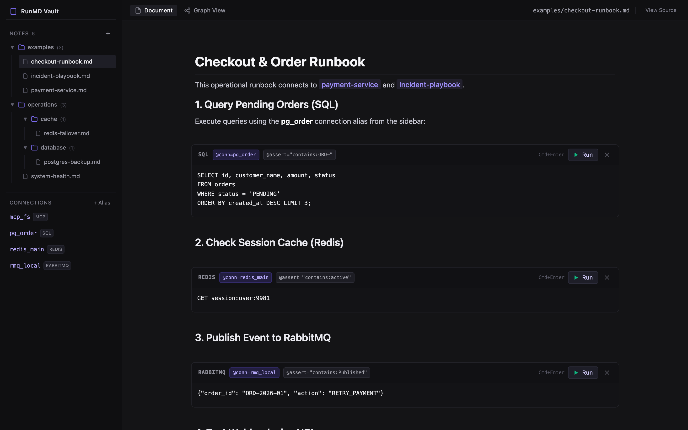
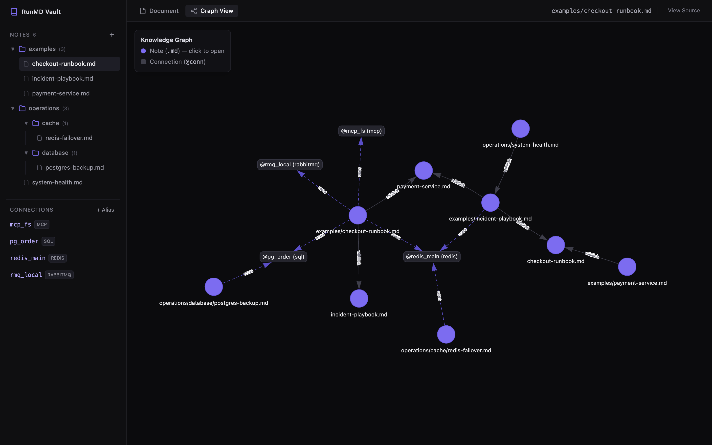

# ⚡ RunMD

**RunMD** is an *Executable Markdown Notebook & Knowledge Graph* (combining Jupyter Notebook + Postman/Database Client + Obsidian Graph + AI Agent Test Engine) built with **Golang** (Single Binary Architecture).

## 📸 Screenshots

<p align="center">
  
  
</p>

---

## 🌟 Key Features

1. **Pure Markdown (`.md`) Source**:
   - Notes are stored in clean, plain `.md` files that are version-control (Git) friendly and editable in any Markdown editor.
   - Uses Obsidian-style Wikilinks `[[note-name]]` or `[[note-name|display text]]` to link notes bidirectionally.

2. **Multi-Protocol Execution Engine**:
   - Supported block runners:
     - `sh` / `bash` / `zsh` (Local shell commands)
     - `curl` / `http` (HTTP requests & API testing)
     - `go` / `golang` (On-the-fly Go code compilation and execution)
     - `js` / `javascript` (Node.js / Bun script runner)
     - `sql` (PostgreSQL / MySQL queries via `@conn` alias)
     - `redis` (CLI / cache commands)
     - `rabbitmq` (Event publishing / message broker queueing)
     - `mcp` (Model Context Protocol JSON-RPC tool caller)

3. **Connection Manager & Aliases (`@conn`)**:
   - Manage database, Redis, RabbitMQ, and MCP Server connections directly via the sidebar UI.
   - Use aliases (e.g. `@conn=pg_order`, `@conn=redis_main`) to keep credentials separate from your Markdown content.

4. **Obsidian-Style Knowledge Graph**:
   - Interactive visual network graph displaying relationships between notes (`.md`) and connection aliases (`@conn`).
   - Click any note node in the graph to jump directly to it.

5. **AI Agent Automated Testing**:
   - Code blocks support `@assert="..."` validation attributes (e.g., `@assert="contains:ORD-"`, `@assert="status == 200"`).
   - Headless CLI Mode for CI/CD pipelines or AI Agents:
     ```bash
     ./runmd -test checkout-runbook.md
     ```
   - REST API Endpoint:
     ```bash
     curl -s "http://localhost:8080/api/agent/test?note=checkout-runbook"
     ```

6. **Native Obsidian UI & Split Editor**:
   - Document Flow view with Jupyter-style collapsible execution output drawers.
   - Collapsible folder tree with expand/collapse states.
   - Resizable Raw Markdown View Source drawer with real-time bidirectional auto-sync.
   - In-place text editing with auto-save on blur / outside click.

---

## 🚀 Getting Started

### 1. Build & Run
```bash
# Clone the repository
git clone https://github.com/mrbagir/runmd.git
cd runmd

# Build binary
go build -o runmd .

# Start server
./runmd
```

Open your browser at:
👉 **[http://localhost:8080](http://localhost:8080)**

---

### 2. CLI Flags
| Flag | Default | Description |
|------|---------|-------------|
| `-host` | `127.0.0.1` | Bind address. RunMD executes code on your machine, so it listens on localhost only by default; use `0.0.0.0` only on a trusted network |
| `-port` | `8080` | HTTP server port |
| `-dir` | `./notes` | Directory path where `.md` notes are stored |
| `-conn` | `./connections.json` | Path to connections configuration file |
| `-test` | `""` | Run automated headless tests on a specific note (e.g., `-test checkout-runbook.md`) |

> **Note:** `sql` and `redis` blocks use the real `psql` / `redis-cli` when installed. Otherwise, and always for `rabbitmq` and `mcp`, RunMD returns a clearly marked `[SIMULATED]` response so example notes work with zero setup.

### 3. Assertions
| Rule | Passes when |
|------|-------------|
| `contains:<text>` | output contains the text |
| `not_contains:<text>` | output does not contain the text |
| `status == 200` | an HTTP 200 response is detected |
| `rows > 0` | SQL output reports at least one row |
| `exit_code == 0` | the block ran without error |

An unrecognised rule **fails** (so typos never pass silently).

### 4. Development
```bash
go vet ./... && go test -race ./...
```

| File | Responsibility |
|------|----------------|
| `main.go` | Flags, startup, headless `-test` mode |
| `handlers.go` | HTTP routes, JSON helpers, same-origin guard, embedded UI |
| `notes.go` | Note storage (list / find / save / rename / delete) |
| `parser.go` | Markdown parsing: wikilinks, code blocks, `@meta` |
| `executor.go` | Block runners and note test reports |
| `assert.go` | `@assert` evaluation |
| `graph.go` | Knowledge-graph builder |
| `state.go` | Connection registry (thread-safe, persisted to JSON) |
| `models.go` | Shared types |

---

## 📝 Markdown Block Format

Example code block with connection metadata and assertion rules:

````markdown
# Checkout Runbook
Connected to [[payment-service]].

```sql @conn=pg_order @assert="contains:ORD-"
SELECT id, customer_name, amount, status FROM orders WHERE status = 'PENDING';
```

```redis @conn=redis_main @assert="contains:active"
GET session:user:9981
```

```curl @assert="status == 200"
curl -s -i https://httpbin.org/get?service=checkout
```

```go @assert="contains:VALID"
package main
import "fmt"
func main() {
    fmt.Println("Pipeline Status: VALID & READY")
}
```
````
